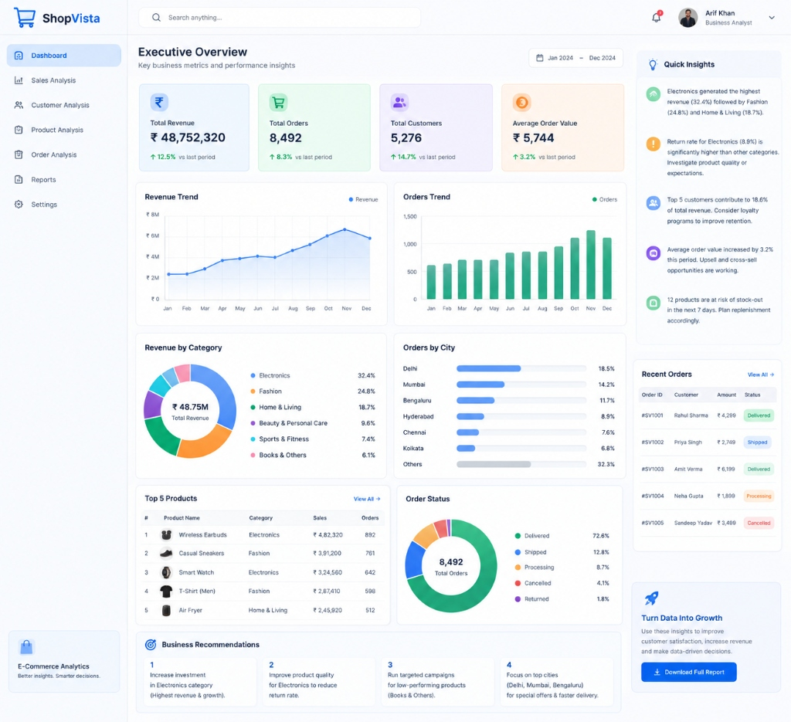
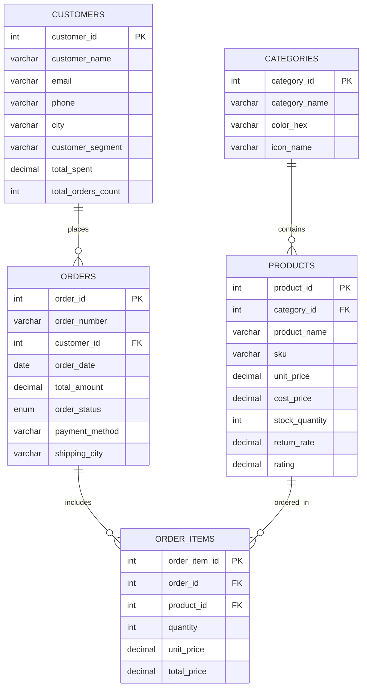

# 📊 ShopVista - E-Commerce Business Analysis Platform




> An end-to-end, portfolio-grade **E-Commerce Business Analytics Platform** designed for Executive Stakeholders, Category Managers, and Business Analysts. Built with **Python (Flask)**, **MySQL 8.0**, **Tailwind CSS**, and **Chart.js**, delivering actionable insights across revenue, order fulfillment, product margins, return rate anomalies, and customer lifetime value (CLV).

---

## 📌 Executive Overview & Problem Statement

Modern e-commerce platforms handle thousands of transactions across multiple product categories, fulfillment hubs, and payment channels. Business leaders require **real-time visibility** into financial health, operational bottlenecks, and customer purchasing patterns to make data-driven decisions.

### 🎯 Key Business Highlights (2024 Audit Period)
* **Total Revenue (GMV):** **₹ 48,752,320** (`↑ 12.5%` vs previous period)
* **Total Order Volume:** **8,492 orders** (`↑ 8.3%` vs previous period)
* **Active Customer Base:** **5,276 customers** (`↑ 14.7%` vs previous period)
* **Average Order Value (AOV):** **₹ 5,744** (`↑ 3.2%` vs previous period)
* **Category Dominance:** Electronics accounts for **32.4%** of gross revenue, followed by Fashion (**24.8%**) and Home & Living (**18.7%**).
* **Return Rate Alert:** Electronics displays an elevated return rate of **8.9%**, triggering a supplier quality review recommendation.
* **Pareto Concentration:** Top 5 VIP customer accounts generate **18.6%** of total revenue.
* **Inventory Stock-Out Risk:** 12 SKUs require immediate replenishment in the next 7 days.

---

## 🖼️ Dashboard Architecture & Visual Design

The UI is a pixel-perfect recreation of modern analytics design standards with:
1. **Executive KPI Cards:** Revenue, Orders, Customer Base, and AOV with percentage growth chips.
2. **Revenue & Orders Velocity Trends:** Dual synchronized charts (Spline Area & Rounded Bar) tracking monthly seasonal peaks.
3. **Category Share Donut Chart:** Dynamic center metrics (`₹ 48.75M`) and custom legend.
4. **City Fulfillment Bar Chart:** Geographical demand distribution across Delhi (18.5%), Mumbai (14.2%), Bengaluru (11.7%), etc.
5. **Top 5 Revenue Products Table:** Ranking bestsellers by gross revenue and order volume.
6. **Order Fulfillment Funnel:** Donut breakdown of Delivered (72.6%), Shipped (12.8%), Processing (8.7%), Cancelled (4.1%), Returned (1.8%).
7. **Strategic Business Recommendations:** 4 prioritized data-backed action items.
8. **Quick Insights & Live Order Feed:** Real-time business alerts and latest transactional status.
9. **Automated Report Exporter:** 1-click CSV and printable executive briefing generator.

---

## 🗄️ Database Architecture (MySQL 8.0)

### Entity Relationship Diagram



---

## 💡 Real-World SQL Business Analyst Queries

All queries are pre-written and benchmarked in [`database/business_analysis_queries.sql`](database/business_analysis_queries.sql):

### 1. Month-Over-Month (MoM) Growth using Window Functions
```sql
WITH monthly_metrics AS (
    SELECT 
        YEAR(order_date) AS order_year,
        MONTH(order_date) AS order_month,
        DATE_FORMAT(order_date, '%b') AS month_name,
        COUNT(order_id) AS monthly_orders,
        SUM(total_amount) AS monthly_revenue
    FROM orders
    GROUP BY YEAR(order_date), MONTH(order_date), DATE_FORMAT(order_date, '%b')
)
SELECT 
    month_name,
    monthly_orders,
    ROUND(((monthly_orders - LAG(monthly_orders, 1) OVER (ORDER BY order_month)) / 
           LAG(monthly_orders, 1) OVER (ORDER BY order_month)) * 100, 2) AS order_growth_pct,
    CONCAT('₹ ', FORMAT(monthly_revenue, 0)) AS revenue_formatted,
    ROUND(((monthly_revenue - LAG(monthly_revenue, 1) OVER (ORDER BY order_month)) / 
           LAG(monthly_revenue, 1) OVER (ORDER BY order_month)) * 100, 2) AS revenue_growth_pct
FROM monthly_metrics
ORDER BY order_month ASC;
```

### 2. Category Margin & Profit Contribution Analysis
```sql
SELECT 
    c.category_name,
    COUNT(oi.order_item_id) AS units_sold,
    CONCAT('₹ ', FORMAT(SUM(oi.total_price), 0)) AS category_revenue,
    ROUND((SUM(oi.total_price) / (SELECT SUM(total_price) FROM order_items)) * 100, 1) AS revenue_share_pct,
    ROUND(SUM(oi.total_price - (p.cost_price * oi.quantity)), 2) AS gross_profit,
    ROUND((SUM(oi.total_price - (p.cost_price * oi.quantity)) / SUM(oi.total_price)) * 100, 2) AS gross_margin_pct
FROM categories c
JOIN products p ON c.category_id = p.category_id
LEFT JOIN order_items oi ON p.product_id = oi.product_id
GROUP BY c.category_id, c.category_name
ORDER BY SUM(oi.total_price) DESC;
```

### 3. RFM Customer Segmentation (Recency, Frequency, Monetary)
```sql
WITH customer_rfm AS (
    SELECT 
        c.customer_id,
        c.customer_name,
        c.city,
        DATEDIFF('2024-12-31', MAX(o.order_date)) AS recency_days,
        COUNT(o.order_id) AS frequency,
        SUM(o.total_amount) AS monetary_value
    FROM customers c
    JOIN orders o ON c.customer_id = o.customer_id
    GROUP BY c.customer_id, c.customer_name, c.city
)
SELECT 
    customer_name,
    city,
    recency_days,
    frequency,
    CONCAT('₹ ', FORMAT(monetary_value, 0)) AS total_spent,
    CASE 
        WHEN recency_days <= 30 AND frequency >= 5 THEN 'Champion / VIP'
        WHEN recency_days <= 60 AND frequency >= 3 THEN 'Loyal Customer'
        WHEN recency_days > 90 AND frequency >= 3 THEN 'At Risk / Churning'
        WHEN frequency = 1 THEN 'New / One-Time Buyer'
        ELSE 'Regular Buyer'
    END AS rfm_segment
FROM customer_rfm
ORDER BY monetary_value DESC
LIMIT 10;
```

---

## 🚀 Quick Start & Installation

### Prerequisites
* **Python 3.10+**
* **MySQL Server 8.0+** (Running locally on port 3306 or via XAMPP)
* **Git**

### Step 1: Clone or Navigate to the Repository
```bash
cd ecommerce-business-analysis
```

### Step 2: Install Python Dependencies
```bash
pip install -r requirements.txt
```

### Step 3: Configure Database Credentials
Edit `.env` (or copy from `.env.example`):
```env
DB_HOST=localhost
DB_PORT=3306
DB_USER=root
DB_PASSWORD=your_mysql_password
DB_NAME=ecommerce_analytics
PORT=5000
```

### Step 4: Run Database Migration & Seeder
This command creates all tables, views, and seeds the **8,492 orders**, **5,276 customers**, and **₹ 48,752,320** revenue data into MySQL:
```bash
python database/seed_data.py
```

### Step 5: Start the Analytics Application
```bash
python app.py
```
Open your browser and navigate to: **`http://localhost:5000`**

*(On Windows, you can simply double-click **`run.bat`** to run everything automatically with 1 click!)*

---

## 📁 Project Directory Structure

```
ecommerce-business-analysis/
├── app.py                             # Flask web server & REST API endpoints
├── config.py                          # App and MySQL configuration loader
├── database/
│   ├── db.py                          # Database manager, connection pool & query helpers
│   ├── schema.sql                     # Full MySQL DDL schema, views, and indexes
│   ├── seed_data.py                   # Data generator populating exact benchmark metrics
│   └── business_analysis_queries.sql  # 10 Industry-standard Business Analyst SQL queries
├── static/
│   ├── css/
│   │   └── style.css                  # Modern UI styling & animations
│   ├── js/
│   │   └── dashboard.js               # Chart.js charts, navigation switcher, and search
├── templates/
│   └── index.html                     # Executive Dashboard Jinja2 HTML template
├── .env.example                       # Environment variables template
├── .env                               # Local database configuration
├── .gitignore                         # Git ignore configuration
├── requirements.txt                   # Python package dependencies
├── run.bat                            # 1-Click Windows execution script
├── README.md                          # Complete project documentation
└── GITHUB_PUSH_GUIDE.md               # Step-by-step Hindi + English GitHub push guide
```

---

## 👨‍💼 Author & Credits
* **Project Name:** E-commerce Business Analysis (ShopVista)
* **Role:** Business Analyst / Data Analyst
* **Tech Stack:** Python, Flask, MySQL, Tailwind CSS, Chart.js

---
*For step-by-step instructions on uploading this repository to GitHub, please see [GITHUB_PUSH_GUIDE.md](GITHUB_PUSH_GUIDE.md).*
